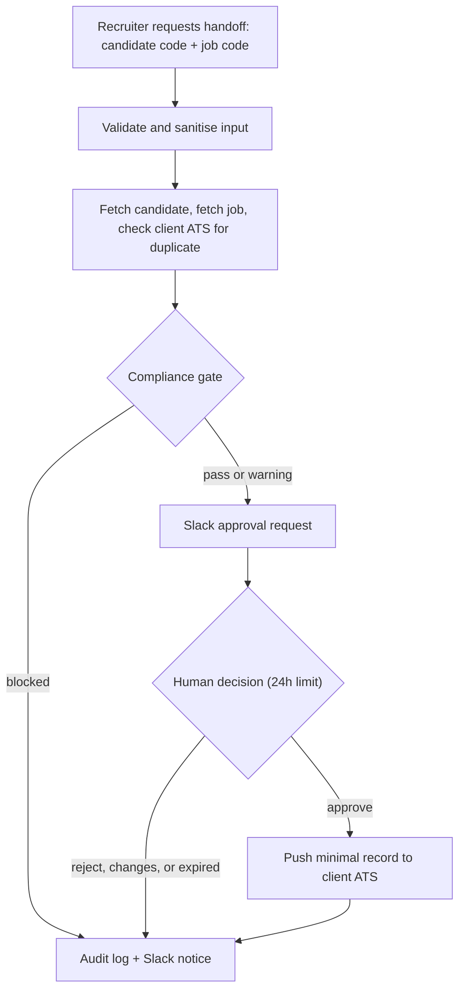

# Candidate Handoff: CRM to ATS (Demo)

An n8n workflow that moves a candidate from a recruitment agency's CRM, through a compliance gate and a human approval, into the client's ATS, while keeping zero candidate data after the run.

> **Status:** working demo built on stand-in systems (Airtable plays both the agency CRM and the client ATS) with fake data only. It is a prototype for pitching and piloting, not a production system.

---

## The problem

AI agents can write a job spec in seconds and rank a shortlist well. What they still can't do is get a candidate out of an agency's CRM, through compliance, and into the client's ATS, because nobody built the road between those two systems. Today that handoff is manual: someone checks the paperwork, copies details across and hopes nothing is missed.

## What it does

1. A recruiter requests a handoff with a candidate code and a job code.
2. The workflow pulls the candidate and the job, and checks whether the client already has this candidate.
3. A compliance gate checks the agency's records for evidence that the required checks were done.
4. A human approves, rejects or requests changes through a Slack-linked form. No answer in 24 hours means nothing is sent.
5. On approval, a minimal record is pushed to the client ATS.
6. A metadata-only audit row is written and the recruiter is notified in Slack.

**Design decision:** the gate verifies *evidence that checks were done* (consent, right to work, ID, background check, references). It does not run those checks itself. They need certified providers and carry legal liability, so the agency keeps using its own.

---

## Architecture



Each external system sits behind one thin HTTP adapter node, so the Airtable stand-ins can be swapped for a real CRM or ATS connector without changing the compliance logic.

## Compliance gate

| Check | Blocks when |
|---|---|
| Input and sources | Codes are malformed, or any source can't be read (fail-safe) |
| Records found | Candidate or job not found, or required fields missing |
| Consent | Not granted, wrong client scope, or older than the configured limit |
| Right to work | Not verified, wrong country, or expired (warns when expiry is near) |
| Identity | Not verified |
| Background check | Job requires one and the result isn't clear |
| References | Fewer than the job requires |
| Cross-border data | Candidate is outside the job's country with no transfer consent |
| Duplicate | Candidate is already in the client's ATS for this job |

Any block stops the submission. Warnings (such as a near right-to-work expiry) go to the human reviewer. The consent age limit (90 days) and expiry warning window (30 days) are demo defaults at the top of the **Normalise and Check** node, not legal rules. Confirm them with each agency.

## Guardrails and human-in-the-loop

- **Approval gate:** nothing reaches the client ATS without a human decision (Approve, Reject, Request changes).
- **Fail-safe:** unreadable sources block the submission instead of guessing. A failed ATS push is logged as `PUSH_FAILED`, never as submitted.
- **Input validation:** codes are pattern-checked so bad input can't reach an Airtable formula.
- **Retries:** HTTP nodes retry 3 times with a fixed 2-second delay.

## Zero data-retention design

- n8n execution data is not saved (success, error, manual or progress).
- `Audit_Log` holds codes, outcome, reasons and reviewer only. No names, emails, CVs or raw payloads.
- Slack messages contain codes, never personal details.
- The reviewer's note is never written anywhere.
- Only the minimum fields go to the client ATS.

---

## Tech stack

n8n, Airtable (stand-in CRM and ATS), Slack, Python 3 (standard library only).

## Repository contents

| File | Purpose |
|---|---|
| `airtable_setup.py` | Creates the four Airtable tables and seeds fake data |
| `candidate_handoff_workflow.json` | The n8n workflow, ready to import |

## Setup

1. **Airtable:** create an empty base and a personal access token with scopes `data.records:read`, `data.records:write`, `schema.bases:read` and `schema.bases:write`, with access to that base only.
2. **Create the tables:**
   ```
   export AIRTABLE_PAT="your_token"
   export AIRTABLE_BASE_ID="your_base_id"
   python airtable_setup.py --dry-run
   python airtable_setup.py
   ```
   On Windows PowerShell use `$env:AIRTABLE_PAT="your_token"` and `$env:AIRTABLE_BASE_ID="your_base_id"`. Use only the part of the base ID that starts with `app`. The script creates `Agency_Candidates`, `Client_Jobs`, `Client_ATS_Candidates` and `Audit_Log`. It is safe to re-run: existing tables are skipped and not re-seeded.
3. **Slack:** create `#handoff-approvals` (private) and `#handoff-log`, create a Slack app with the `chat:write` scope, and invite the bot to both channels.
4. **n8n:** import `candidate_handoff_workflow.json`, then:
   - paste the Base ID into the **Config** node
   - select your Airtable credential on the five Airtable nodes
   - select your Slack credential and channel IDs on the two Slack nodes (approvals and log)
5. **Activate** the workflow and send a request:
   ```
   POST /webhook/submit-candidate
   {"candidate_code": "CAND-001", "job_code": "JOB-1001", "recruiter": "you"}
   ```

## Demo scenarios

| Candidate | Job | Result |
|---|---|---|
| CAND-001 | JOB-1001 | Passes, goes to Slack approval |
| CAND-001 | JOB-1002 | Blocked: consent covers a different client |
| CAND-002 | JOB-1001 | Blocked: no consent |
| CAND-003 | JOB-1001 | Blocked: right to work pending |
| CAND-004 | JOB-1001 | Passes with a warning: right to work expires soon |
| CAND-005 | JOB-1002 | Blocked: background check not run |
| CAND-006 | JOB-1001 | Blocked: already in the client's ATS |
| CAND-007 | JOB-1001 | Blocked: no cross-border data consent |

The same candidate can pass or fail depending on the job (CAND-005 is blocked for JOB-1002 but passes for JOB-1001), because the rules come from the role.

## Triggering from Airtable without a paid plan

Airtable automation scripts need a paid plan. A free alternative is a Button field that opens a URL calling the webhook with a GET request:

1. Add a single select field **Submit to job** (`JOB-1001`, `JOB-1002`) and a Button field with the action **Open URL** and this formula (replace the address with your n8n URL):
   ```
   "https://YOUR-N8N-URL/webhook/submit-candidate?candidate_code=" & ENCODE_URL_COMPONENT({candidate_code}) & "&job_code=" & ENCODE_URL_COMPONENT({Submit to job}) & "&recruiter=Demo"
   ```
2. In n8n, set the **Webhook** node's HTTP Method to `GET`, and change the first line of **Validate Input** to `const body = $('Webhook').first().json.query || {};`.

n8n must be reachable from wherever the click happens. Codes travel in the URL here, which is acceptable for pseudonymous demo codes but not for a real pilot, where POST should be used.

## Known limitations

- **Demo systems:** Airtable stands in for both the CRM and the ATS. A real pilot needs the agency's actual connectors.
- **Wait with saving off:** confirm the approval step resumes correctly with execution saving turned off before relying on it.
- **Approval link:** confirm it is protected by n8n's signed resume URL, since anyone with the link could otherwise decide.
- **Webhook access:** the webhook is open to anyone with the URL. Add header authentication for a pilot.
- **Retries:** n8n's built-in retry uses a fixed delay, not exponential backoff.
- **Rules vary by country:** the checks reflect common agency practice (UK-style). Confirm requirements with each agency and jurisdiction.

## Roadmap

- Replace the Airtable adapters with a real CRM and ATS connector.
- Add authentication on the webhook and approval step.
- Make the compliance rules configurable per client.

## Author

Built by Josh-code. Questions or pilot enquiries: (https://www.linkedin.com/in/joshua-adelasoye-b29474172/).
